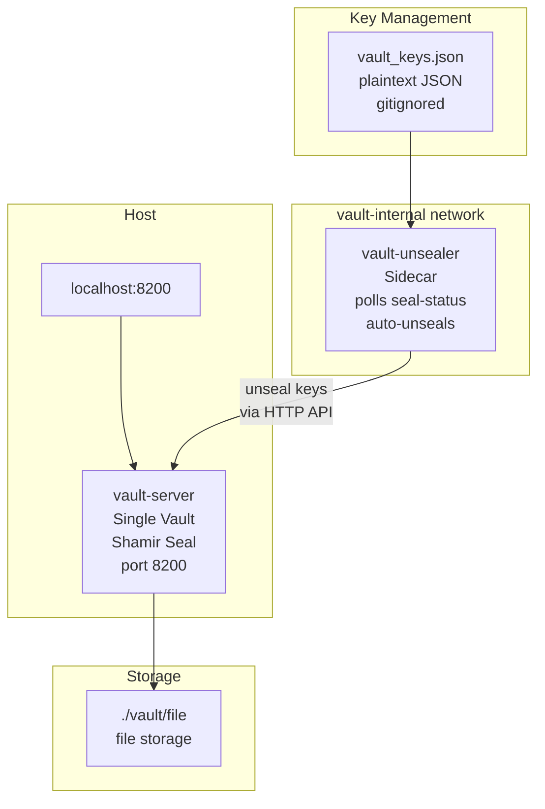

# Vault Transit Stack

Single HashiCorp Vault with Shamir seal, unsealed automatically by a lightweight
sidecar container. Vault runs as a single Docker container with file-based storage,
bound to localhost only. The `vault-unsealer` sidecar polls the seal-status endpoint
and applies keys whenever Vault starts sealed.

The legacy dual-vault transit auto-unseal configuration is archived in
[docs/legacy-transit/](docs/legacy-transit/) for reference.

---

## Architecture



---

## Prerequisites

| Requirement | Minimum Version | Check |
|-------------|----------------|-------|
| Docker Engine | 24.0+ | `docker --version` |
| Docker Compose | v2.0+ | `docker compose version` |

> For manual/remote unseal as an alternative, Ansible is available in
> [docs/ansible-alternative/](docs/ansible-alternative/).

---

## Quick Start

1. **Clone the repository:**
   ```bash
   git clone <REPOSITORY_URL>
   cd vault-transit-stack
   ```

2. **Create the environment file:**
   ```bash
   cp .env.example .env
   # Adjust HOST_UID and HOST_GID to match your user: id -u && id -g
   ```

3. **Make scripts executable:**
   ```bash
   chmod +x scripts/start.sh scripts/stop.sh vault/entrypoint.sh
   ```

4. **Start vault:**
   ```bash
   ./scripts/start.sh
   ```

5. **Initialize and configure auto-unseal:**

   See [docs/single-vault-setup.md](docs/single-vault-setup.md) for the complete
   first-time initialization guide, including sidecar key configuration and
   unseal verification.

---

## First-Time Setup

Full initialization walkthrough: [docs/single-vault-setup.md](docs/single-vault-setup.md)

---

## Services

| Service | Container | Host Port | Description |
|---------|-----------|-----------|-------------|
| vault | `vault-server` | `127.0.0.1:8200` | Single Vault instance with Shamir seal and file storage. Starts sealed — unsealed automatically by the sidecar. |
| vault-unsealer | `vault-server-unsealer` | — | Lightweight sidecar (Alpine + curl + jq). Polls `/v1/sys/seal-status` every N seconds and applies unseal keys when sealed. |

---

## Environment Variables

| Variable | Default | Description |
|----------|---------|-------------|
| `COMPOSE_PROJECT_NAME` | `vault-transit` | Docker Compose project name |
| `NETWORK_NAME` | `vault-internal` | Internal Docker bridge network name |
| `VAULT_TAG` | `1.15.4` | Vault image version (pin to specific tag) |
| `HOST_UID` | `1000` | Host user ID for container file ownership |
| `HOST_GID` | `1000` | Host group ID for container file ownership |
| `VAULT_PORT` | `8200` | Host port (bound to 127.0.0.1) |
| `VAULT_CONTAINER_NAME` | `vault-server` | Container and hostname |
| `VAULT_CONTAINER_LISTEN_PORT` | `8200` | Vault listener port inside container |
| `VAULT_INTERNAL_ADDR` | `http://127.0.0.1:8200` | Vault API address for self-reference |
| `VAULT_LOG_LEVEL` | `info` | Vault log verbosity (trace/debug/info/warn/error) |
| `VAULT_KEY_SHARES` | `5` | Shamir key shares for `vault operator init` |
| `VAULT_KEY_THRESHOLD` | `3` | Shamir threshold for `vault operator init` |
| `VAULT_MEM_LIMIT` | `256m` | Memory hard limit for vault container |
| `VAULT_MEM_RESERVATION` | `128m` | Memory soft reservation for vault container |
| `UNSEALER_POLL_INTERVAL` | `10` | Seconds between seal-status checks by the sidecar |
| `UNSEALER_KEYS_FILE` | `/run/secrets/vault_keys.json` | Path inside sidecar container to the unseal keys file |
| `UNSEALER_MEM_LIMIT` | `64m` | Memory hard limit for the unsealer sidecar |
| `UNSEALER_MEM_RESERVATION` | `32m` | Memory soft reservation for the unsealer sidecar |

---

## File Structure

```
vault-transit-stack/
├── .env                              # Local config (gitignored — never commit)
├── .env.example                      # Environment variable template
├── .gitignore
├── .gitattributes
├── docker-compose.yml                # Vault + unsealer sidecar service definitions
├── scripts/
│   ├── start.sh                      # Build and start vault container
│   └── stop.sh                       # Stop vault container
├── vault/
│   ├── Dockerfile                    # hashicorp/vault + shadow + gettext
│   ├── entrypoint.sh                 # envsubst config template, exec vault server
│   ├── config/
│   │   ├── vault.hcl.template        # Config template (envsubst at runtime)
│   │   └── vault.hcl                 # Generated at runtime (gitignored)
│   ├── file/                         # Vault storage (gitignored, bind-mounted)
│   └── logs/                         # Vault logs (gitignored, bind-mounted)
├── vault-unsealer/
│   ├── Dockerfile                    # Alpine + curl + jq
│   ├── entrypoint.sh                 # Poll-and-unseal loop
│   └── keys/
│       ├── vault_keys.json.example   # Key file template (committed)
│       └── vault_keys.json           # Plaintext unseal keys (gitignored)
└── docs/
    ├── single-vault-setup.md         # First-time initialization guide
    ├── ansible-alternative/          # Manual/remote unseal (alternative)
    │   ├── ansible.cfg               # Inventory path, retry disabled
    │   ├── inventory.yml             # Default: local connection
    │   ├── vault-unseal.yml          # Manual unseal playbook
    │   ├── README.md                 # Ansible setup and automation guide
    │   └── vars/
    │       ├── vault_keys.yml.example  # Unseal keys template (committed)
    │       └── vault_keys.yml          # Encrypted unseal keys (gitignored)
    └── legacy-transit/               # Archived dual-vault transit setup
        ├── README.md                 # Archive context + when transit IS appropriate
        ├── vault-a/                  # Transit unseal provider (archived)
        ├── vault-b/                  # Transit-unsealed vault (archived)
        ├── docker-compose.yml        # Dual-vault compose (archived)
        ├── legacy-setup.md
        ├── vault-architecture.md
        └── first-time-setup.md
```

---

## Lifecycle Management

### Start

```bash
./scripts/start.sh
```

### Stop

```bash
./scripts/stop.sh
# or: docker compose down
```

Data in `vault/file/` is preserved across restarts.

### Unseal

Unsealing is automatic via the `vault-unsealer` sidecar. Once
`vault-unsealer/keys/vault_keys.json` is populated and the stack is running,
the sidecar detects the sealed state and applies keys on the next poll cycle.

For manual unsealing as an alternative (remote hosts, troubleshooting):

```bash
cd docs/ansible-alternative
ansible-playbook vault-unseal.yml --ask-vault-pass
```

See [docs/ansible-alternative/README.md](docs/ansible-alternative/README.md) for setup.

### Seal manually

```bash
docker exec vault-server vault operator seal
```

### Reset all data (destructive)

```bash
docker compose down
rm -rf vault/file/* vault/logs/*
```

Forces re-initialization. Repeat the first-time setup guide.

### Update Vault version

```bash
# Update VAULT_TAG in .env, then:
./scripts/start.sh
```

### View logs

```bash
docker compose logs -f
docker compose logs -f vault
```

---

## Network Architecture

Vault runs on the `vault-internal` Docker bridge network. The port binding
`127.0.0.1:8200` restricts access to the local machine only.

To connect an external application stack to vault:

```yaml
# In your application's docker-compose.yml:
networks:
  vault-internal:
    external: true
    name: vault-internal
```

Then reference vault as `http://vault-server:8200` from your application containers.

---

## Security Notes

- **`.env` is gitignored** — never commit it. Use `.env.example` as the reference.
- **Unseal keys are gitignored** — `vault-unsealer/keys/vault_keys.json` and
  `docs/ansible-alternative/vars/vault_keys.yml` are excluded.
  Commit only the `.example` templates.
- **TLS is disabled** by default (`tls_disable = true`) — acceptable for
  localhost-only deployments. Enable TLS via the `listener` stanza before
  exposing Vault to untrusted networks.
- **`IPC_LOCK` capability** prevents Vault's memory from being swapped to disk.
  `disable_mlock = true` is set as a fallback for environments that cannot
  grant this capability.
- **Port is localhost-only:** `127.0.0.1:8200`. Do not change to `0.0.0.0`
  without enabling TLS and network-level authentication.
- **no_log: true** on unseal key submission tasks prevents key material from
  appearing in Ansible output or log files.

---

## Documentation

| Document | Description |
|----------|-------------|
| [docs/single-vault-setup.md](docs/single-vault-setup.md) | Complete first-time initialization guide |
| [docs/ansible-alternative/README.md](docs/ansible-alternative/README.md) | Manual/remote unseal via Ansible (alternative) |
| [docs/legacy-transit/README.md](docs/legacy-transit/README.md) | When transit auto-unseal is the right choice |
