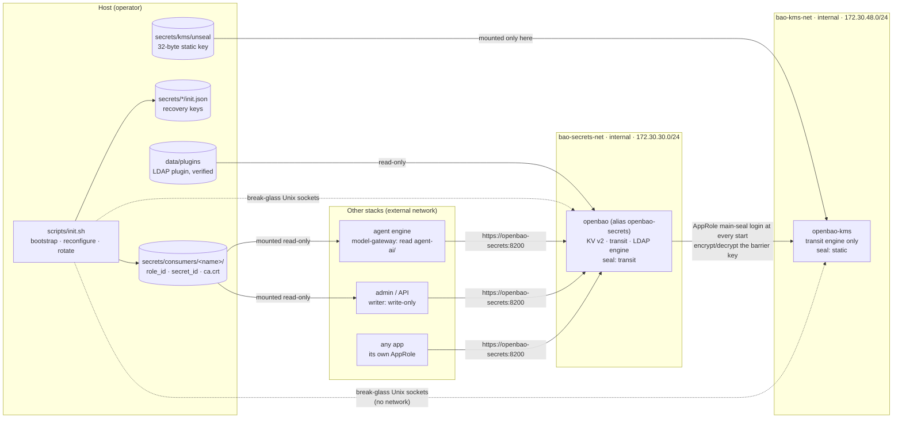
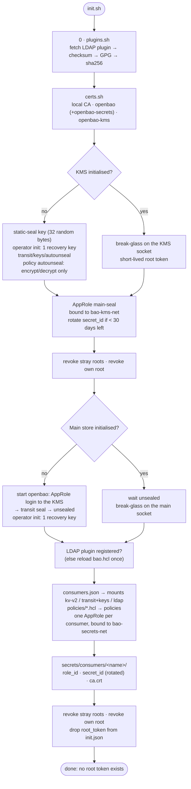
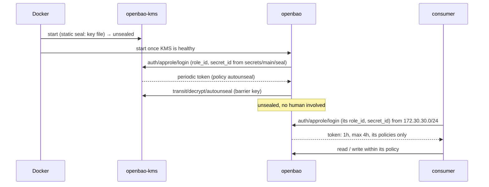
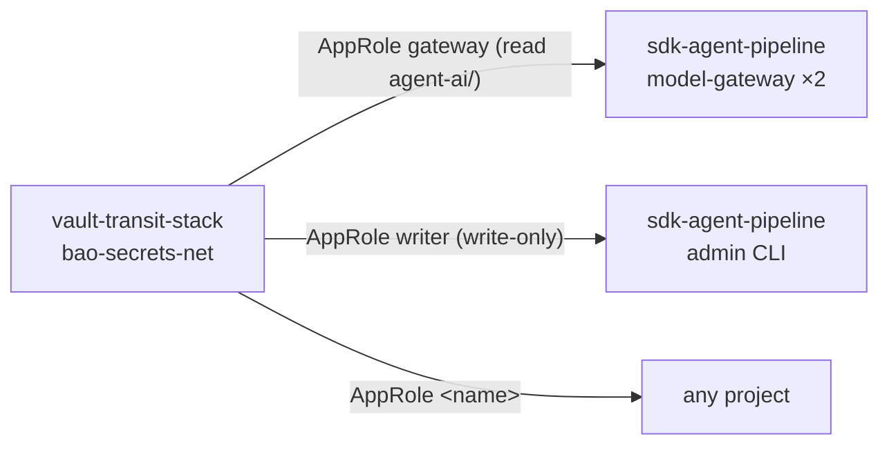

<a id="readme-top"></a>

# Vault Transit Stack

**OpenBao with a transit mini KMS**: a secret store that unseals itself, with nobody holding
Shamir shares, and that other projects plug into as a module: an AppRole login on every start,
no plaintext keys on disk outside the KMS's own seal key, and declarative consumers.

## Purpose: an independent blueprint

The stack is **self-contained**: it builds, runs and is tested on its own, and no other
project is needed for it to work. It is a **blueprint to transplant** wherever a project needs
a secret store with a security plus: no unseal shares held by people, no root token left
behind, least privilege per consumer, network-bound credentials, verified plugins and an
audit trail.

| A project that needs… | Does |
|---|---|
| to keep API keys or passwords out of its database | declares a `kv-v2` mount and a reader / a write-only writer in `config/consumers.json` |
| to sign tokens without holding the private key | declares a `transit` mount with an `ed25519` key |
| a directory's service account rotated by the store | declares an `ldap` mount (the verified LDAP plugin) |
| an agentic core | uses [sdk-agent-pipeline](https://github.com/ancrz/sdk-agent-pipeline): its default consumers here are exactly its gateway and writer |

<p align="right">(<a href="#readme-top">back to top</a>)</p>

---

## Architecture



| Piece | What it is |
|---|---|
| `openbao-kms` | A transit-only OpenBao. It unseals itself with OpenBao's **static seal** from a key mounted only into it, and holds the key `transit/autounseal` that seals the main store. Production swaps it for a cloud KMS/HSM seal, or runs it on another host (a separate trust domain). |
| `openbao` | The main store. **Transit seal** against the KMS: it unseals at every start without people. Mounts, policies and AppRoles come from `config/consumers.json` and `config/policies/`. |
| `main-seal` AppRole | The main store's seal credential on the KMS. Not a static token: the container logs in at every start (OpenBao Agent's auto-auth pattern) and the seal renews the token while it runs, so a stop of any length never leaves it without one. Bound to the KMS subnet; its `secret_id` lives a year and is rotated 30 days ahead. |
| Consumer AppRoles | One per entry in `consumers.json`, bound to the secrets subnet (token and `secret_id`). Credentials land in `secrets/consumers/<name>/` (dir 750, files 640, host group). Consumers re-read `secret_id` at each login, so rotation needs no restart. |
| Break-glass | A Unix socket per store (`data/run`, `data/kms-run`, mode 700), never on a network. Since OpenBao 2.5.3 the unauthenticated generate-root endpoints are off by default; these sockets are the one place they stay on, so the recovery key can mint a short-lived root token. `init.sh` uses it on every re-run and revokes it, plus any stray root token. |
| External plugins | OpenBao has no egress. `scripts/plugins.sh` fetches the official LDAP secrets plugin, checks the release checksum, **OpenBao's GPG release key** (fingerprint pinned) and a **pinned sha256**; `bao.hcl` declares the same sha256 and OpenBao checks it again before it runs. |
| Audit | A file audit device declared in each config (secrets HMAC-hashed); a device in the config cannot be disabled through the API. |

Both containers are hardened: non-root (`HOST_UID:HOST_GID`), read-only root filesystem,
`cap_drop: ALL`, `no-new-privileges`, internal networks only, **no host ports**, TLS 1.2+ with
a local CA, json-file logs with rotation.

<p align="right">(<a href="#readme-top">back to top</a>)</p>

---

## The unseal pipeline

What `scripts/init.sh` does. It is idempotent: the first run bootstraps, every later run
reconfigures and rotates, and only does what is missing.



A normal start after that is only `docker compose up`:



<p align="right">(<a href="#readme-top">back to top</a>)</p>

---

## Prerequisites

| Requirement | Check |
|---|---|
| Docker Engine 24+ with Compose v2 | `docker compose version` |
| `jq`, `openssl`, `python3`, `curl` on the host | used by `init.sh`, `certs.sh`, `plugins.sh` |
| `gpg` (recommended) | without it the plugin's release signature is skipped with a warning; the pinned sha256 still decides |
| Internet on the host for the first `init.sh` | to fetch the plugin release (OpenBao itself never has egress) |

<p align="right">(<a href="#readme-top">back to top</a>)</p>

---

## Quick start

```bash
git clone https://github.com/ancrz/vault-transit-stack.git
cd vault-transit-stack
./scripts/start.sh        # first run: creates .env, bootstraps everything (≈30 s)
./scripts/status.sh       # both stores: initialized=true sealed=false; TLS days left
```

Expected end of the first run:

```text
[openbao] main store initialised and auto-unsealed through the KMS
[openbao] mount agent-ai/ (kv-v2) enabled
[openbao] gateway: new secret_id (valid 8760h; the old one was missing)
[openbao] writer: new secret_id (valid 8760h; the old one was missing)
[openbao] main store configured: mounts [agent-ai], AppRoles [gateway, writer]; root token revoked
```

<p align="right">(<a href="#readme-top">back to top</a>)</p>

---

## Declaring consumers

`config/consumers.json` is the whole contract. The default declares what the
[agent engine](https://github.com/ancrz/sdk-agent-pipeline) needs:

```json
{
  "mounts": [
    { "path": "agent-ai", "type": "kv-v2", "description": "Model provider keys" }
  ],
  "consumers": {
    "gateway": { "policies": ["agent-gateway"], "token_ttl": "1h", "token_max_ttl": "4h" },
    "writer":  { "policies": ["agent-writer"],  "token_ttl": "1h", "token_max_ttl": "4h" }
  }
}
```

| Field | Values |
|---|---|
| `mounts[].type` | `kv-v2` · `transit` (with `"keys": [{"name": "jwt", "type": "ed25519"}]`) · `ldap` (the LDAP secrets plugin; one mount per directory) |
| `consumers.<name>.policies` | names of `config/policies/<policy>.hcl` |
| `token_ttl`, `token_max_ttl` | AppRole token lifetimes (default `1h`, `4h`) |

Policies shipped: `agent-gateway.hcl` (read `agent-ai/data/*`), `agent-writer.hcl` (create and
update, metadata read/delete/list, **never read a value**), and
`directory-admin.hcl.example` for an `ldap` mount (configure the engine, read only the
credential OpenBao rotates). Edit, then re-run `./scripts/init.sh`. Removing an entry does not
delete it from the store.

### Connecting a project

```yaml
# In the consumer's docker-compose.yml
services:
  my-app:
    group_add: ["${HOST_GID:-1000}"]          # reads its AppRole files (mode 640)
    networks: [bao-secrets]
    volumes:
      - ${VAULT_STACK_DIR}/secrets/consumers/my-app:/run/openbao:ro
    environment:
      BAO_ADDR: https://openbao-secrets:8200   # the alias, never "openbao"
networks:
  bao-secrets:
    external: true
    name: bao-secrets-net
```

The app logs in with `role_id` and `secret_id` from `/run/openbao`, trusts `/run/openbao/ca.crt`,
and re-reads `secret_id` at each login. A Python client that does exactly this (token reuse,
a short read cache, stale-if-error, fail-closed) is `orchestrator/secrets.py` in the agent engine.



<p align="right">(<a href="#readme-top">back to top</a>)</p>

---

## Operations

| Task | Command |
|---|---|
| Start / stop (data kept, next start auto-unseals) | `./scripts/start.sh` · `./scripts/stop.sh` |
| Status of both stores and certificates | `./scripts/status.sh` |
| Reconfigure (new consumer, mount, policy) | edit `config/`, then `./scripts/init.sh` |
| Rotate AppRole `secret_id`s (seal and consumers) | `./scripts/init.sh` — monthly, e.g. from cron; rotates what has < 30 days left |
| Reissue TLS (keeps the CA) | `./scripts/certs.sh --force && docker compose restart` |
| Days left on certificates | `./scripts/certs.sh --check` |
| A new plugin version | change `PLUGIN_TAG`/`BINARY_SHA256` in `scripts/plugins.sh` and the `plugin` stanza in `config/openbao/bao.hcl` |
| Logs | `docker compose logs -f openbao` · audit: `data/main-logs/audit.log` |
| Reset everything (destructive) | `./scripts/stop.sh -v && rm -rf secrets data` |

### What to back up

`secrets/` (the KMS unseal key, both recovery keys, the CA) and `data/main` + `data/kms`
(raft storage). Losing `secrets/kms/unseal/kms-unseal-1.key` and the KMS data loses the main
store's barrier key: keep them in a separate place from the data backups.

<p align="right">(<a href="#readme-top">back to top</a>)</p>

---

## Troubleshooting

| Symptom | Cause and fix |
|---|---|
| `openbao` loops on `waiting for the seal AppRole` | the store was never bootstrapped: `./scripts/init.sh` |
| `seal AppRole login failed` | the seal `secret_id` expired or the KMS is down: `docker compose up -d openbao-kms`, then `./scripts/init.sh` (rotates it through the KMS break-glass) |
| `the main store is still sealed` | the KMS is unreachable from `bao-kms-net`, or its unseal key file is missing: `docker compose logs openbao-kms` |
| consumer login: `unauthorized by CIDR restrictions` | the consumer is not on `bao-secrets-net` (or the subnet changed: re-run `init.sh` after changing `BAO_SECRETS_SUBNET`) |
| consumer: TLS name mismatch | it uses `https://openbao:8200`; use the alias `https://openbao-secrets:8200` (certificates issued before the alias are reissued by `certs.sh`) |
| consumer: `permission denied` reading its files | add `group_add: ["${HOST_GID}"]` to the consumer (files are mode 640, the host group) |
| `403 permission denied` on a path | its policy does not grant it: edit `config/policies/<policy>.hcl`, re-run `init.sh` |
| `plugins.sh`: signature or sha256 mismatch | the download is not the pinned release; do not bypass it: check `PLUGIN_TAG`/`BINARY_SHA256` and the network |
| `break-glass failed` | `secrets/*/init.json` (the recovery key) does not belong to this store's data: restore both from the same backup |

<p align="right">(<a href="#readme-top">back to top</a>)</p>

---

## Environment variables

| Variable | Default | Description |
|---|---|---|
| `OPENBAO_IMAGE` | `openbao/openbao:2.7.0` | Image for both stores (pinned) |
| `BAO_CONTAINER_PREFIX` | `bao` | Container name prefix |
| `HOST_UID` / `HOST_GID` | `1000` | Container user; owner of `secrets/` and `data/` |
| `BAO_KMS_NETWORK_NAME` / `BAO_KMS_SUBNET` | `bao-kms-net` / `172.30.48.0/24` | KMS ↔ main store; the seal AppRole is bound to it |
| `BAO_SECRETS_NETWORK_NAME` / `BAO_SECRETS_SUBNET` | `bao-secrets-net` / `172.30.30.0/24` | Main store ↔ consumers; consumer AppRoles are bound to it |
| `BAO_SEAL_SECRET_TTL` | `8760h` | `secret_id` lifetime (seal and consumers) |
| `BAO_SEAL_ROTATE_BEFORE_H` | `720` | Rotate when fewer hours than this are left |
| `BAO_CONSUMERS_FILE` / `BAO_POLICY_DIR` | `./config/consumers.json` / `./config/policies` | Declarative configuration |
| `BAO_CERT_DAYS` / `BAO_CA_DAYS` | `397` / `3650` | Certificate lifetimes |
| `BAO_LOG_MAX_SIZE` / `BAO_LOG_MAX_FILE` | `10m` / `5` | json-file log rotation |
| `OPENBAO_MEM_LIMIT`, `OPENBAO_CPU_LIMIT`, `OPENBAO_KMS_*` | `256m`, `0.5`, `128m`, `0.25` | Resource limits |

A variable set on the command line wins over `.env`
(`BAO_CONSUMERS_FILE=./other.json ./scripts/init.sh`).

<p align="right">(<a href="#readme-top">back to top</a>)</p>

---

## File structure

```text
vault-transit-stack/
├── docker-compose.yml               # openbao-kms + openbao, internal networks, no host ports
├── .env.example                     # no secrets: everything sensitive is generated in secrets/
├── config/
│   ├── consumers.json               # mounts + consumers (the contract with other projects)
│   ├── policies/                    # one .hcl per policy named in consumers.json
│   └── openbao/
│       ├── kms.hcl                  # static seal, transit only, break-glass socket, audit
│       ├── bao.hcl                  # transit seal, plugin stanza, break-glass socket, audit
│       ├── kms-autounseal.hcl       # the seal's policy on the KMS (encrypt/decrypt only)
│       └── openbao-gpg-pub-20240618.asc   # OpenBao's release key (plugin signatures)
├── scripts/
│   ├── start.sh / stop.sh / status.sh
│   ├── init.sh                      # the unseal pipeline (bootstrap, reconfigure, rotate)
│   ├── certs.sh                     # local CA + server certificates
│   └── plugins.sh                   # fetch and verify external plugins
├── secrets/                         # gitignored: keys, recovery keys, AppRoles, TLS
└── data/                            # gitignored: raft storage, audit logs, sockets, plugins
```

<p align="right">(<a href="#readme-top">back to top</a>)</p>

---

## Security notes

- **No root token survives a run**: `init.sh` revokes its own and any stray one, and strips
  `root_token` from `init.json`. Administration goes through break-glass (recovery key +
  host-only socket).
- **Least privilege per consumer**: the default writer can store a provider key but never
  read it back; the gateway can read but never write.
- **Network binding**: AppRole tokens and `secret_id`s only work from their subnet. A login
  from elsewhere gets `source address … unauthorized by CIDR restrictions`.
- **The demo trust anchor is a file**: `secrets/kms/unseal/kms-unseal-1.key`. For production,
  put the KMS on another host or replace it with a cloud KMS / HSM seal on the main store.
- `secrets/` and `data/` are gitignored; never commit them.

<p align="right">(<a href="#readme-top">back to top</a>)</p>

---

## License

[Mozilla Public License 2.0](LICENSE), the same as OpenBao: use it, fork it, ship it
commercially; files of this project you modify stay under MPL-2.0. OpenBao itself (MPL-2.0)
runs from its official image and is not included. `config/openbao/openbao-gpg-pub-20240618.asc`
is OpenBao's published release-signing public key, included unchanged to verify plugin releases.

<p align="right">(<a href="#readme-top">back to top</a>)</p>
