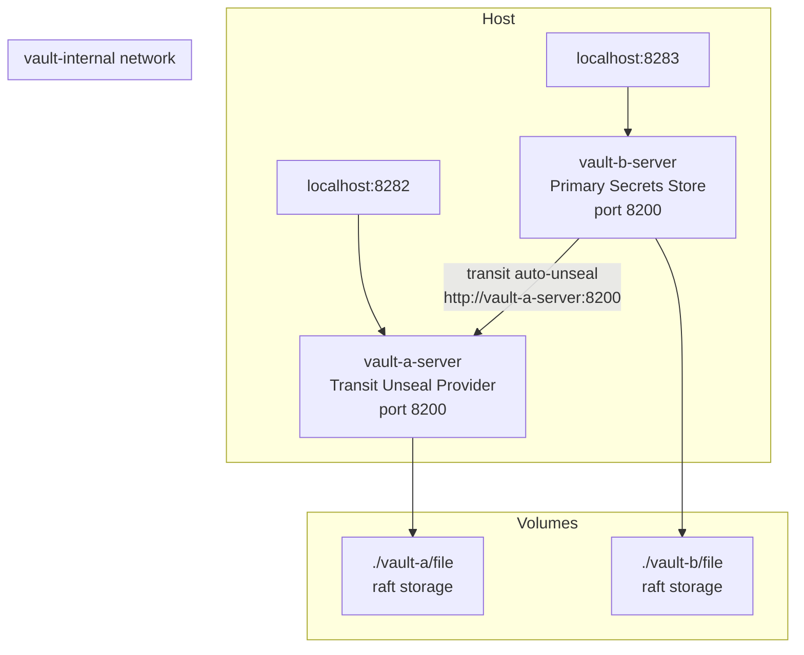

# Vault Transit Stack

Dual HashiCorp Vault deployment with transit auto-unseal. `vault-a` runs the transit secrets engine and acts as the unseal provider; `vault-b` is the primary secrets store that auto-unseals on every startup by communicating with vault-a's transit engine. Both instances run independently and persistently, bound to localhost-only ports, over a private Docker bridge network.

---

## Architecture



---

## Prerequisites

- **Docker Engine 24+** with Docker Compose v2+
- **Minimum RAM:** 512 MB (256 MB per vault instance)
- **Linux** (Ubuntu 22.04+, Debian 12+) or macOS with Docker Desktop

---

## Quick Start

**First time only** — follow the full initialization sequence in [docs/first-time-setup.md](docs/first-time-setup.md).

For subsequent starts:

1. **Clone the repository:**
   ```bash
   git clone <REPOSITORY_URL>
   cd vault-transit-stack
   ```

2. **Create and configure the environment file:**
   ```bash
   cp .env.example .env
   # Edit .env with your values
   ```

3. **Make scripts executable:**
   ```bash
   chmod +x scripts/start.sh scripts/stop.sh vault-a/entrypoint.sh vault-b/entrypoint.sh
   ```

4. **Start the stack:**
   ```bash
   ./scripts/start.sh
   ```

5. **Access the UIs:**
   - Vault-a: [http://localhost:8282/ui](http://localhost:8282/ui)
   - Vault-b: [http://localhost:8283/ui](http://localhost:8283/ui)

> **First time?** See [docs/first-time-setup.md](docs/first-time-setup.md) for the complete initialization walkthrough, including transit engine configuration and vault-b setup.

---

## Services

| Service | Container | Host Port | Description |
|---------|-----------|-----------|-------------|
| vault-a | `vault-a-server` | `127.0.0.1:8282` | Transit unseal provider. Runs Vault with the transit secrets engine. Must be healthy before vault-b starts. |
| vault-b | `vault-b-server` | `127.0.0.1:8283` | Primary secrets store. Auto-unseals via vault-a's transit engine on every restart. |

---

## Environment Variables

| Variable | Default | Description |
|----------|---------|-------------|
| `COMPOSE_PROJECT_NAME` | `vault-transit` | Docker Compose project name |
| `NETWORK_NAME` | `vault-internal` | Internal Docker bridge network name |
| `VAULT_TAG` | `1.15.4` | Vault image version (pin to a specific tag) |
| `HOST_UID` | `1000` | Host user ID for container file ownership |
| `HOST_GID` | `1000` | Host group ID for container file ownership |
| `VAULT_A_PORT` | `8282` | Host port for vault-a (bound to 127.0.0.1) |
| `VAULT_B_PORT` | `8283` | Host port for vault-b (bound to 127.0.0.1) |
| `VAULT_CONTAINER_LISTEN_PORT` | `8200` | Vault listener port inside containers |
| `VAULT_INTERNAL_ADDR` | `http://127.0.0.1:8200` | vault-a self-reference for transit seal config |
| `VAULT_ROOT_TOKEN_FOR_TRANSIT` | _(empty)_ | vault-a root token (used only in template.final) |
| `VAULT_TRANSIT_KEY_NAME` | `autounseal` | Name of the transit key used for unsealing |
| `VAULT_TRANSIT_MOUNT_PATH` | `transit/` | Mount path of the transit secrets engine |
| `VAULT_KEY_SHARES` | `1` | Shamir key shares for vault operator init |
| `VAULT_KEY_THRESHOLD` | `1` | Shamir key threshold for vault operator init |
| `VAULT_A_UNSEAL_KEY` | _(empty)_ | vault-a Shamir unseal key — set after init |
| `VAULT_B_TRANSIT_TOKEN` | _(empty)_ | vault-b transit token — set after transit setup |
| `VAULT_A_MEM_LIMIT` | `256m` | Memory hard limit for vault-a container |
| `VAULT_A_MEM_RESERVATION` | `128m` | Memory soft reservation for vault-a container |
| `VAULT_B_MEM_LIMIT` | `256m` | Memory hard limit for vault-b container |
| `VAULT_B_MEM_RESERVATION` | `128m` | Memory soft reservation for vault-b container |

---

## File Structure

```
vault-transit-stack/
├── .env                              # Secrets and local config (never commit)
├── .env.example                      # Environment variable template
├── .gitignore                        # Excludes .env, runtime data, generated configs
├── docker-compose.yml                # Service definitions for both vault instances
├── scripts/
│   ├── start.sh                      # Startup script (--init flag for first-time setup)
│   └── stop.sh                       # Clean shutdown script
├── vault-a/
│   ├── Dockerfile                    # vault-a image (hashicorp/vault + shadow)
│   ├── entrypoint.sh                 # Starts vault, auto-unseals via VAULT_A_UNSEAL_KEY
│   ├── config/
│   │   ├── vault.hcl                 # Active config (static, no template substitution)
│   │   ├── vault.hcl.template.init   # Reference template for initial setup phase
│   │   ├── vault.hcl.template.final  # Reference template with transit seal stanza
│   │   └── autounseal-policy.hcl     # HCL policy granting vault-b transit access
│   ├── file/                         # Vault storage (gitignored, bind-mounted)
│   └── logs/                         # Vault logs (gitignored, bind-mounted)
├── vault-b/
│   ├── Dockerfile                    # vault-b image (hashicorp/vault + shadow + gettext)
│   ├── entrypoint.sh                 # Runs envsubst on template, starts vault
│   ├── config/
│   │   ├── config.hcl.template       # Config template with transit seal placeholders
│   │   └── config.hcl                # Generated at runtime by entrypoint (gitignored)
│   ├── file/                         # Vault storage (gitignored, bind-mounted)
│   └── logs/                         # Vault logs (gitignored, bind-mounted)
└── docs/
    ├── first-time-setup.md           # Step-by-step initialization walkthrough
    ├── vault-architecture.md         # Architecture, diagrams, security notes
    └── legacy-setup.md               # Original monolith README + migration notes
```

---

## Lifecycle Management

### Start the stack

```bash
# Normal start (both vaults, requires prior initialization)
./scripts/start.sh

# Init mode (vault-a only, for first-time setup)
./scripts/start.sh --init
```

### Stop the stack

```bash
./scripts/stop.sh
# or: docker compose down
```

Data in `vault-a/file/` and `vault-b/file/` is preserved.

### Reset all data (destructive)

```bash
docker compose down
rm -rf vault-a/file/* vault-b/file/*
```

This forces re-initialization. Repeat the first-time setup.

### Update Vault version

```bash
# Update VAULT_TAG in .env, then rebuild
./scripts/start.sh
```

### View logs

```bash
# All services
docker compose logs -f

# Single service
docker compose logs -f vault-a
docker compose logs -f vault-b
```

---

## Network Architecture

Both vault instances run on the `vault-internal` Docker bridge network. Ports are bound to `127.0.0.1` only — they are not accessible from other machines on the network.

To connect an external application stack to vault-b:

```yaml
# In your application's docker-compose.yml:
networks:
  vault-internal:
    external: true
    name: vault-internal
```

Then reference vault-b as `http://vault-b-server:8200` from within your application containers.

---

## Security Notes

- **`.env` must never be committed.** It is excluded by `.gitignore`. Use `.env.example` as the reference.
- **TLS is disabled** — suitable for localhost-only deployments. Enable TLS via the `listener` stanza before exposing vault to untrusted networks.
- **Transit token scope:** `VAULT_B_TRANSIT_TOKEN` is restricted to `autounseal-policy.hcl` — it can only encrypt and decrypt the `autounseal` transit key. It has no access to any other vault-a data.
- **Ports are localhost-only:** `127.0.0.1:8282` and `127.0.0.1:8283`. Do not change to `0.0.0.0` without enabling TLS and authentication.
- **`IPC_LOCK` capability:** Added to prevent swap of sensitive memory. `disable_mlock = true` is set as a fallback for environments that cannot grant this capability.

---

## Documentation

| Document | Description |
|----------|-------------|
| [docs/first-time-setup.md](docs/first-time-setup.md) | Complete step-by-step initialization guide |
| [docs/vault-architecture.md](docs/vault-architecture.md) | Architecture diagrams, component roles, security model |
| [docs/legacy-setup.md](docs/legacy-setup.md) | Original monolith README and migration change log |
