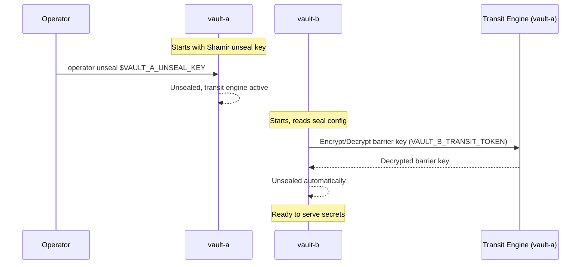
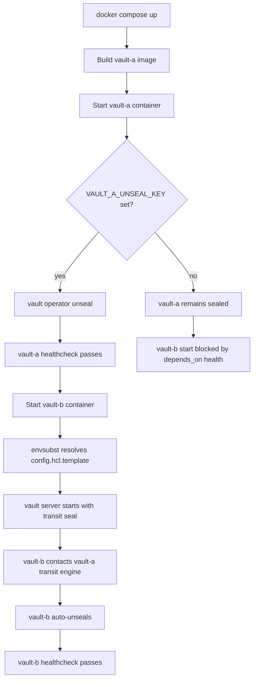
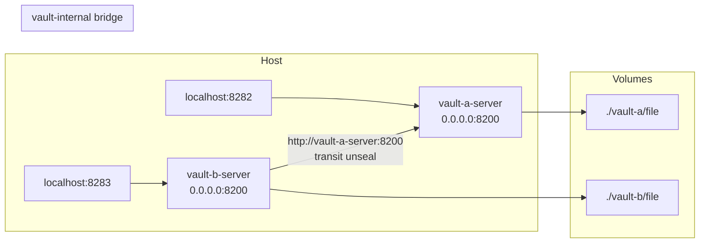

# Vault Transit Stack — Architecture

## Overview

This stack runs two independent HashiCorp Vault instances. `vault-a` acts as the transit unseal provider; `vault-b` is the primary secrets store. The relationship is directional: vault-b depends on vault-a for unsealing, but vault-a has no knowledge of vault-b.

Both instances persist data to local bind-mounted directories and communicate over a private Docker bridge network (`vault-internal`). Neither instance is reachable from the internet — ports bind to `127.0.0.1` only.

---

## Components

### vault-a — Transit Unseal Provider

- Runs the `transit` secrets engine with a single key (`autounseal`).
- Exposes a scoped policy (`autounseal-policy.hcl`) granting only encrypt/decrypt on the transit key.
- Unseals itself on startup using `VAULT_A_UNSEAL_KEY` (a standard Shamir key).
- Serves as the unseal dependency for vault-b. Must be healthy before vault-b starts.
- Does **not** use transit auto-unseal itself — it uses a direct Shamir unseal key.

### vault-b — Primary Secrets Store

- Uses `seal "transit"` stanza pointing to `vault-a-server:8200`.
- Auto-unseals on every container start via vault-a's transit engine, using `VAULT_B_TRANSIT_TOKEN`.
- The token is scoped to the `autounseal` policy — it cannot access any other vault-a data.
- Config is generated at runtime from `config.hcl.template` via `envsubst` — no secrets in the image.

---

## Transit Auto-Unseal Flow

---

## Startup Sequence

---

## Recovery Keys vs Unseal Keys

| Concept | vault-a | vault-b |
|---------|---------|---------|
| Unseal mechanism | Shamir key (`VAULT_A_UNSEAL_KEY`) | Transit auto-unseal via vault-a |
| Recovery keys | N/A (Shamir only) | Generated during `vault operator init` on vault-b |
| On container restart | Entrypoint runs `vault operator unseal` automatically | vault-b re-contacts vault-a transit engine automatically |
| Manual unseal required | Only if `VAULT_A_UNSEAL_KEY` is unset | Never — as long as vault-a is healthy |
| Root token | Generated at vault-a init | Generated at vault-b init |

**Recovery keys** are generated when vault-b is initialized. Store them securely — they are needed to regenerate the root token or perform recovery operations, but are not needed for normal unsealing.

---

## Network Architecture

- The `vault-internal` network is isolated — no external services can reach it unless explicitly connected.
- vault-b resolves vault-a by the Docker hostname `vault-a-server` (set via `container_name` and `hostname`).
- To connect an external stack (e.g., an application consuming vault-b secrets), add it to the `vault-internal` network or expose vault-b on a host port and use `127.0.0.1:8283`.

---

## Security Considerations

- **TLS is disabled** (`tls_disable = true`). This is appropriate for localhost-only deployments. Enable TLS before exposing vault to any untrusted network.
- **`disable_mlock = true`** prevents vault from locking memory pages. Required in Docker without `--cap-add IPC_LOCK` or when running as non-root. The compose file adds `IPC_LOCK` capability, but `disable_mlock` remains set for compatibility with constrained environments.
- **Transit token scope**: `VAULT_B_TRANSIT_TOKEN` is scoped to `autounseal-policy.hcl` — it can only encrypt and decrypt the `autounseal` key. It cannot list, read, or write any other vault-a data.
- **No Docker socket**: vault-a does not mount the Docker socket. The original co-dependency (vault-a stopping vault-b) has been removed.
