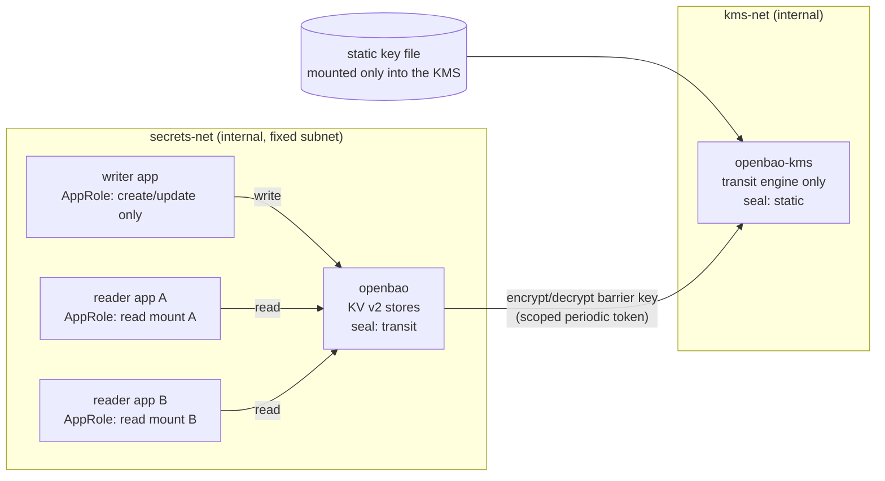
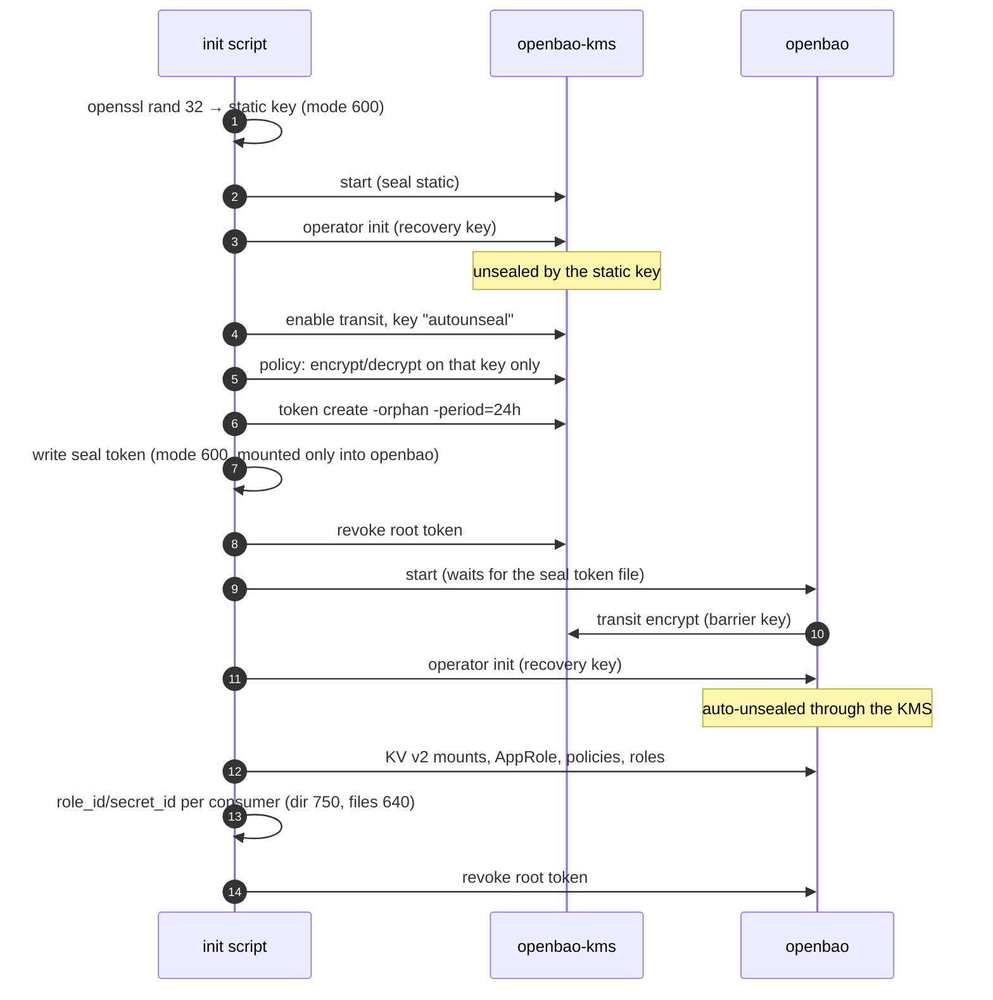
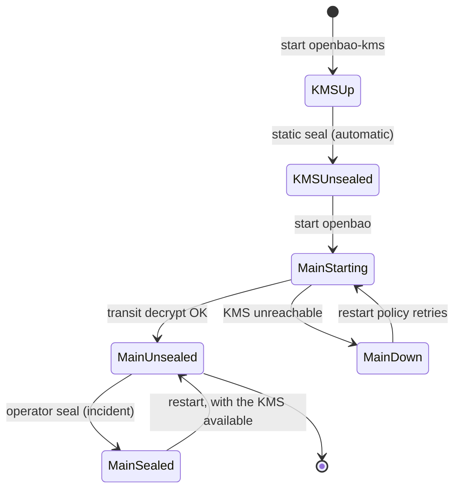
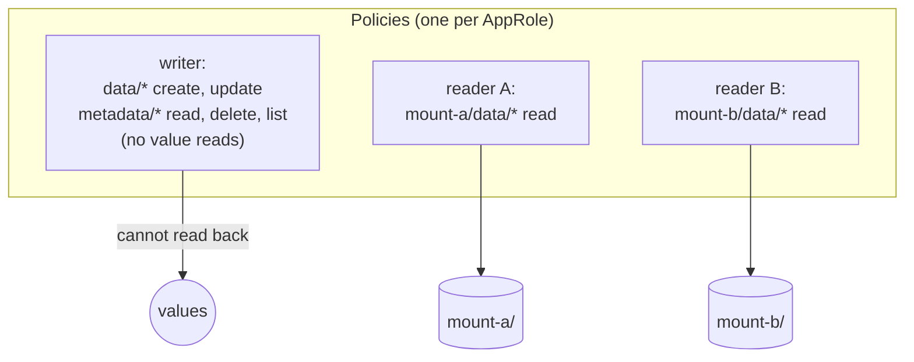

# OpenBao refactor guide

How to move this stack from HashiCorp Vault 1.15.4 with a Shamir-key sidecar to **OpenBao with a transit mini KMS**. The design is already running in **vanguard-control** (remediation R1, 2026-09-30); this guide ports it back.

Why the refactor is needed (license, support, unseal design): [refactor-to-openbao.md](refactor-to-openbao.md).

---

## 1. Target architecture

| Piece | Today (this stack) | After |
|---|---|---|
| Image | `hashicorp/vault:1.15.4` (BSL 1.1, out of support) | `openbao/openbao:2.7.0` (MPL 2.0, Alpine, about 80 MB) |
| Unseal | `vault-unsealer` polls and posts Shamir keys from plaintext `vault_keys.json` | Main store: `seal "transit"` against the mini KMS. Mini KMS: built-in `seal "static"`. No custom unseal loop. |
| Storage | `file` | `raft` (snapshots, path to a cluster) |
| Listener | `tls_disable = true` | TLS from a local CA, `tls_min_version = "tls12"` |
| Audit | none | declarative `audit "file"` stanza (cannot be disabled through the API) |
| Root token | kept (the legacy transit design even put it in the seal stanza) | revoked after bootstrap; break-glass via recovery key + `generate-root` |
| Access | one token for everything | one AppRole per consumer, bound to the network subnet, minimal policy |
| Container | root processes, `IPC_LOCK` | host UID, read-only root fs, `cap_drop: ALL`, `no-new-privileges`, no host ports |

---

## 2. Bootstrap sequence

Rules the script follows:
- **Idempotent:** it re-runs only what is missing.
- **Tokens travel on stdin,** never in `argv` (`docker compose exec -T svc sh -c 'read -r t; BAO_TOKEN="$t" exec bao …'`), so they never appear in `ps`.
- **Never set `BAO_ADDR` in the main store's environment.** The transit seal reads `BAO_ADDR`/`BAO_TOKEN`, so a local `BAO_ADDR` would point the seal at itself. Pass it per `exec`.
- **Status:** `jq '.initialized // empty'` treats `false` as empty. Test with `has("initialized")` instead.

---

## 3. Restart and failure behaviour

Verified in vanguard-control:
- A restart of both containers unseals both automatically.
- With the KMS stopped, the main store fails to start ("Error configuring seal transit") and retries. When the KMS returns, the main store starts and unseals on its own. This is fail closed: no secret is served without the KMS.

**Sealing is not access control.** Keep the store unsealed; control access with AppRole, policies, short token TTLs and the audit log. `seal` is the emergency brake.

---

## 4. Access model

Vanguard's instance of this model:

| AppRole | Policy | Can | Cannot |
|---|---|---|---|
| `api` | `vanguard-api` | create/update in `vanguard-ai/` and `vanguard-automation/`; read metadata (to verify a write) | read any value |
| `gateway` | `vanguard-gateway` | read `vanguard-ai/` (provider API keys) | read `vanguard-automation/`, write anything |
| `controller` | `vanguard-controller` | read `vanguard-automation/` (SSH, Ansible Vault passwords) | read `vanguard-ai/` |

- **Network binding:** every role has `token_bound_cidrs` and `secret_id_bound_cidrs` set to the secrets subnet. A login from any other network is refused ("unauthorized by CIDR restrictions").
- **File layout:** consumers mount only `secrets/openbao/consumers/<consumer>/` (`role_id`, `secret_id`, `ca.crt`), never the directory holding the static key or the recovery keys. Files are mode 640 with the host group, and the container gets `group_add`.
- **Audit:** secret values are HMAC-hashed in the audit log, so a key never appears there in plaintext.

---

## 5. Porting steps for this repository

1. **Images and configs:** replace `vault/Dockerfile` with the official `openbao/openbao` image. Add `config/openbao/kms.hcl` (raft, TLS, `seal "static"`, audit) and `config/openbao/bao.hcl` (raft, TLS, `seal "transit"` → `https://openbao-kms:8200`, audit). Both drop `disable_mlock`, which OpenBao 2.7 no longer accepts.
2. **Compose:** services `openbao-kms` and `openbao` with `user: HOST_UID:HOST_GID`, `read_only`, `tmpfs /tmp`, `cap_drop: ALL`, `no-new-privileges`. Networks: `kms-net` (both) and `secrets-net` (main store and consumers), with no host ports. Keep `127.0.0.1` only if a local operator port is really needed.
3. **Certificates:** a local CA, with certificates for `openbao` and `openbao-kms` (SAN: the service name, `localhost`, `127.0.0.1`).
4. **Init script:** the sequence of section 2. Store the recovery keys under `secrets/`, mode 600, never in the repository.
5. **Data migration** from the current Vault: `vault kv get`/`bao kv put` per path, or `bao operator migrate` for storage. Verify each path by version through metadata before switching clients.
6. **Retire:** delete `vault-unsealer/` and `vault-unsealer/keys/vault_keys.json` once the transit seal works. Keep `docs/legacy-transit/` as history.
7. **Checklist:**
   - restarts unseal automatically;
   - with the KMS down, the main store fails closed;
   - the policy matrix holds;
   - a login from outside the subnet is refused;
   - the root tokens are revoked;
   - the audit log shows HMAC values only.

**Production:** replace the mini KMS with a cloud KMS or HSM seal on the main store, or move the mini KMS to another host, which makes it a separate trust domain. From OpenBao 2.7 the cloud KMS seals are external plugins (kms plugin type), not part of the core binary.

---

Reference implementation (vanguard-control): `config/openbao/`, `scripts/agent_openbao_certs.sh`, `scripts/agent_openbao_init.sh`, `orchestrator/secrets.py` and `docker-compose.yml` (profile `vault`).
